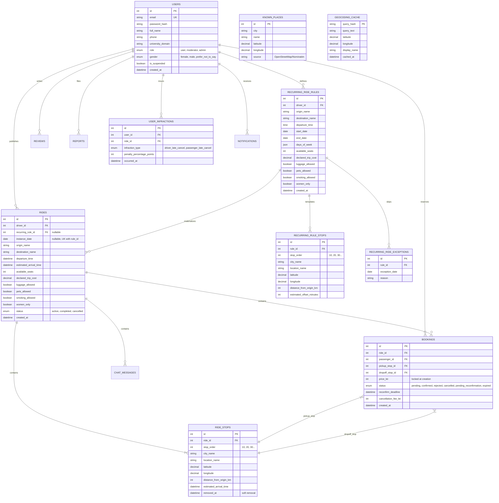

# Implementation Plan · Database Schema & Versioned Migrations (P18 StudRide)

> **Post-build amendments:** During `/build` and PR review on `feat/db-schema-and-migrations`, the implementation applied these approved adjustments to the baseline plan below:
> - `known_places` seeds **only** the 36 localities from `SURVEY.md` (with nullable `latitude`/`longitude` + `source_query`/`queried_on`), populated by `002_seed_known_place_coordinates.sql` via `backend/database/fetch-nominatim.js`; `geocoding_cache` is not pre-seeded.
> - System accounts use neutral addresses (`admin@studride.local`, `moderator@studride.local`) created in `seed.js` with runtime `bcryptjs` hashing from `ADMIN_PASSWORD`/`MODERATOR_PASSWORD` in `.env` (no passwords or hashes committed).
> - Migration `001_initial_schema.sql` uses `ON DELETE RESTRICT` on audit/booking/chat/review/infraction FKs, `ON DELETE SET NULL` on nullable `reports.reporter_id`, `CHECK` constraints (`available_seats >= 1`, `declared_trip_cost >= 0`, `pickup_stop_id <> dropoff_stop_id`, `price_lei >= 0`, `cancellation_fee_lei >= 0`, `reviewer_id <> reviewed_user_id`), `UNIQUE KEY` on stop orders, and composite search/booking indexes.

This document presents the revised implementation plan for the database schema, versioned migrations engine, Docker setup, and idempotent seed script for **StudRide** (P18 Student Carpooling with Segment Matching), strictly adhering to all approved decisions and user corrections:
- [D-003](../agents/DECISIONS.md): MySQL 8 + raw SQL with `mysql2`, no ORM, versioned migrations via `schema_migrations`, idempotent live/local seed.
- [D-004](../agents/DECISIONS.md): User accounts, email authentication, university domain validation.
- [D-005](../agents/DECISIONS.md): Segment seat tracking, non-consumption by pending/expired/rejected/cancelled bookings.
- [D-006](../agents/DECISIONS.md): Recurring rides as rule + exceptions + stop templates, instances materialized on demand.
- [D-007](../agents/DECISIONS.md): Reconfirmation deadlines, lazy lapse tracking, soft stop removal (`removed_at`), stop reordering.
- [D-008](../agents/DECISIONS.md): Post-arrival ratings only for completed rides.
- [D-009](../agents/DECISIONS.md): Dedicated `geocoding_cache` table.
- [D-010](../agents/DECISIONS.md): Locked `price_lei` on bookings, declared trip cost cap.
- [D-011](../agents/DECISIONS.md): Chat messages and notifications in MySQL.
- [D-012](../agents/DECISIONS.md): Full Docker Compose setup (`docker-compose.yml`) + live URL support.
- [D-013](../agents/DECISIONS.md): bcrypt password hashes, RBAC roles (`user`, `moderator`, `admin`), account status.
- [D-016](../agents/DECISIONS.md): Infraction event log for on-read seriousness score computation.
- [D-018](../agents/DECISIONS.md): Private `gender` field for women-only eligibility.
- [D-019](../agents/DECISIONS.md): Exactly 1 seat per booking.

---

## 1. Size
* **Estimate:** **M (Medium)**
* **Scope:** 
  * Docker environment: `docker-compose.yml` (MySQL 8 service + persistent volume) and `.env.example`.
  * Node.js connection pool: `backend/src/db.js`.
  * Lightweight migration runner: `backend/database/migrate.js` (~70 lines of pure Node.js + `mysql2`).
  * 1 initial migration SQL file (`001_initial_schema.sql`) creating **15 tables** with strict constraints and indexes.
  * Idempotent seed runner (`seed.js`) and DML script (`001_seed_initial.sql`) with real OSM/Nominatim coordinates for the survey places, system accounts (`admin`, `moderator`), zero fake users, and zero fake rides.
  * Automated Vitest integration test suite verifying migrations and seed idempotency.

---

## 2. Approach & Alternatives Rejected

### Selected Approach
1. **Lightweight Versioned Migration Runner (No ORM, per D-003):**
   * Raw SQL migration files in `backend/database/migrations/` ordered alphanumerically (`001_initial_schema.sql`).
   * Tracks executed versions in `schema_migrations` (`id`, `version`, `applied_at`).
   * Executes each migration script inside a dedicated transaction (`START TRANSACTION ... COMMIT`), rolling back and halting on failure.
2. **Pre-Seeding Known Places without Fake User/Ride Data (per user requirement):**
   * Instead of generating synthetic rides or test passenger accounts, the seed populates a dedicated `known_places` table containing real stops, cities, and pickup points identified in [SURVEY.md](../../SURVEY.md).
   * Exact coordinates are sourced from OpenStreetMap / Nominatim with `source = 'OpenStreetMap/Nominatim'`.
   * Only essential system administrative accounts (`admin@ulbsibiu.ro` and `moderator@ulbsibiu.ro`) are created for management testing. All colleague accounts and rides will be created by real users post-deployment per the Definition of Done.
3. **Recurring Ride Template Architecture (per D-006):**
   * Splits recurrence into:
     - `recurring_ride_rules`: Master recurrence metadata (origin, destination, departure time of day, active dates, days of week, vehicle capacity, trip cost).
     - `recurring_rule_stops`: Template ordered intermediate stops (stops in steps of 10, distance from origin, estimated offset minutes).
     - `recurring_ride_exceptions`: Driver-skipped calendar dates.
     - `rides`: Concrete materialized instances with `instance_date DATE NULL` and `UNIQUE KEY uq_rule_instance (recurring_rule_id, instance_date)`.
4. **Flexible Stop Ordering & Soft Stop Removal (per D-007):**
   * `stop_order` uses intervals of 10 (10, 20, 30, 40...) so an intermediate stop can be inserted without renumbering all subsequent rows.
   * `ride_stops` includes `removed_at DATETIME NULL`: stops with active or completed bookings are never deleted physically; they are marked with `removed_at` so historical booking waypoints remain referentially intact.
5. **Database Concurrency & Transactional Row-Locking (per D-003, D-005):**
   * MySQL 8 InnoDB engine exclusively.
   * Booking confirmation executes within a transaction locking rows via `SELECT FOR UPDATE` on elementary leg availability.
   * Auto-rejects competing pending requests strictly on legs whose remaining capacity drops to 0.

### Alternatives Rejected
* **Heavyweight ORMs (Prisma, Sequelize, TypeORM):** Rejected by D-003. Adds heavy dependencies, hides raw queries, and interferes with clean `SELECT FOR UPDATE` transactional row locking.
* **Monolithic SQL dump on startup:** Rejected by D-003 amendment. Versioned migrations with a `schema_migrations` table are required for progressive deployments and grading compliance.
* **Hard Deleting Modified Stops:** Rejected by D-007. Hard deleting breaks foreign keys on past bookings and erases audit trails for passengers in `pending_reconfirmation`.
* **Storing Seriousness Score as a Database Column:** Rejected by D-016. An event log (`user_infractions`) replayed on read avoids background cron daemons and eliminates state drift.

---

## 3. Files

| Action | File Path | Purpose |
|---|---|---|
| **[NEW]** | `docker-compose.yml` | Containerized MySQL 8 environment with persistent volume, healthcheck, and port binding. |
| **[NEW]** | `.env.example` | Template environment configuration (`DB_HOST`, `DB_PORT`, `DB_USER`, `DB_PASSWORD`, `DB_NAME`, `JWT_SECRET`). |
| **[NEW]** | `backend/src/db.js` | Connection pool wrapper using `mysql2/promise`. |
| **[NEW]** | `backend/database/migrate.js` | Versioned migration runner tracking applied migrations in `schema_migrations`. |
| **[NEW]** | `backend/database/migrations/001_initial_schema.sql` | DDL script defining all 15 tables with indexes, enums, and foreign keys. |
| **[NEW]** | `backend/database/seed.js` | Idempotent seed runner executing seed data scripts safely. |
| **[NEW]** | `backend/database/seeds/001_seed_initial.sql` | DML script seeding `known_places`, system accounts (`admin`, `moderator`), and `geocoding_cache`. |
| **[NEW]** | `backend/tests/database.test.js` | Automated Vitest integration test verifying migrations, schema structure, foreign keys, and seed idempotency. |

---

## 4. Entity-Relationship Architecture (15 Tables)



---

## 5. Schema DDL Details (`001_initial_schema.sql`)

```sql
-- 1. Schema Migrations Table (D-003)
CREATE TABLE IF NOT EXISTS schema_migrations (
  id INT AUTO_INCREMENT PRIMARY KEY,
  version VARCHAR(255) NOT NULL UNIQUE,
  applied_at DATETIME NOT NULL DEFAULT CURRENT_TIMESTAMP
) ENGINE=InnoDB;

-- 2. Users Table (D-004, D-013, D-018)
CREATE TABLE IF NOT EXISTS users (
  id INT AUTO_INCREMENT PRIMARY KEY,
  email VARCHAR(255) NOT NULL UNIQUE,
  password_hash VARCHAR(255) NOT NULL,
  full_name VARCHAR(150) NOT NULL,
  phone VARCHAR(50) NULL,
  university_domain VARCHAR(100) NULL, -- extracted domain for allowlist matching
  role ENUM('user', 'moderator', 'admin') NOT NULL DEFAULT 'user',
  gender ENUM('female', 'male', 'prefer_not_to_say') NOT NULL DEFAULT 'prefer_not_to_say',
  is_suspended BOOLEAN NOT NULL DEFAULT FALSE,
  created_at DATETIME NOT NULL DEFAULT CURRENT_TIMESTAMP,
  INDEX idx_users_email (email),
  INDEX idx_users_domain (university_domain),
  INDEX idx_users_role (role)
) ENGINE=InnoDB;

-- 3. Known Places Table (Seed Suggestions & Geocoding Autocomplete)
CREATE TABLE IF NOT EXISTS known_places (
  id INT AUTO_INCREMENT PRIMARY KEY,
  city VARCHAR(100) NOT NULL,
  name VARCHAR(255) NOT NULL,
  latitude DECIMAL(10, 7) NOT NULL,
  longitude DECIMAL(10, 7) NOT NULL,
  source VARCHAR(100) NOT NULL DEFAULT 'OpenStreetMap/Nominatim',
  created_at DATETIME NOT NULL DEFAULT CURRENT_TIMESTAMP,
  UNIQUE KEY uq_known_place (city, name),
  INDEX idx_known_places_city (city)
) ENGINE=InnoDB;

-- 4. Recurring Ride Rules (Master Template) (D-006)
CREATE TABLE IF NOT EXISTS recurring_ride_rules (
  id INT AUTO_INCREMENT PRIMARY KEY,
  driver_id INT NOT NULL,
  origin_name VARCHAR(150) NOT NULL,
  destination_name VARCHAR(150) NOT NULL,
  departure_time TIME NOT NULL, -- fixed naming
  start_date DATE NOT NULL,
  end_date DATE NULL,
  days_of_week JSON NOT NULL, -- e.g. ["friday"]
  available_seats INT NOT NULL, -- passenger seats excluding driver (CONTEXT.md)
  declared_trip_cost DECIMAL(10, 2) NOT NULL,
  luggage_allowed BOOLEAN NOT NULL DEFAULT TRUE,
  pets_allowed BOOLEAN NOT NULL DEFAULT FALSE,
  smoking_allowed BOOLEAN NOT NULL DEFAULT FALSE,
  women_only BOOLEAN NOT NULL DEFAULT FALSE,
  created_at DATETIME NOT NULL DEFAULT CURRENT_TIMESTAMP,
  FOREIGN KEY (driver_id) REFERENCES users(id) ON DELETE CASCADE
) ENGINE=InnoDB;

-- 5. Recurring Rule Stops (Template Waypoints) (D-006)
CREATE TABLE IF NOT EXISTS recurring_rule_stops (
  id INT AUTO_INCREMENT PRIMARY KEY,
  rule_id INT NOT NULL,
  stop_order INT NOT NULL, -- in steps of 10: 10, 20, 30...
  city_name VARCHAR(100) NOT NULL,
  location_name VARCHAR(255) NOT NULL,
  latitude DECIMAL(10, 7) NOT NULL,
  longitude DECIMAL(10, 7) NOT NULL,
  distance_from_origin_km INT NOT NULL DEFAULT 0,
  estimated_offset_minutes INT NOT NULL DEFAULT 0,
  FOREIGN KEY (rule_id) REFERENCES recurring_ride_rules(id) ON DELETE CASCADE,
  INDEX idx_rule_stops_order (rule_id, stop_order)
) ENGINE=InnoDB;

-- 6. Recurring Ride Exceptions (D-006)
CREATE TABLE IF NOT EXISTS recurring_ride_exceptions (
  id INT AUTO_INCREMENT PRIMARY KEY,
  rule_id INT NOT NULL,
  exception_date DATE NOT NULL,
  reason VARCHAR(255) NULL,
  created_at DATETIME NOT NULL DEFAULT CURRENT_TIMESTAMP,
  UNIQUE KEY uq_rule_exception (rule_id, exception_date),
  FOREIGN KEY (rule_id) REFERENCES recurring_ride_rules(id) ON DELETE CASCADE
) ENGINE=InnoDB;

-- 7. Rides Table (Materialized Instances & Single Rides) (D-003, D-006, D-010, D-018)
CREATE TABLE IF NOT EXISTS rides (
  id INT AUTO_INCREMENT PRIMARY KEY,
  driver_id INT NOT NULL,
  recurring_rule_id INT NULL,
  instance_date DATE NULL, -- date of materialized occurrence
  origin_name VARCHAR(150) NOT NULL,
  destination_name VARCHAR(150) NOT NULL,
  departure_time DATETIME NOT NULL,
  estimated_arrival_time DATETIME NOT NULL,
  available_seats INT NOT NULL, -- passenger seats excluding driver (CONTEXT.md)
  declared_trip_cost DECIMAL(10, 2) NOT NULL,
  luggage_allowed BOOLEAN NOT NULL DEFAULT TRUE,
  pets_allowed BOOLEAN NOT NULL DEFAULT FALSE,
  smoking_allowed BOOLEAN NOT NULL DEFAULT FALSE,
  women_only BOOLEAN NOT NULL DEFAULT FALSE,
  status ENUM('active', 'completed', 'cancelled') NOT NULL DEFAULT 'active',
  created_at DATETIME NOT NULL DEFAULT CURRENT_TIMESTAMP,
  UNIQUE KEY uq_rule_instance (recurring_rule_id, instance_date),
  FOREIGN KEY (driver_id) REFERENCES users(id) ON DELETE CASCADE,
  FOREIGN KEY (recurring_rule_id) REFERENCES recurring_ride_rules(id) ON DELETE SET NULL,
  INDEX idx_rides_departure (departure_time),
  INDEX idx_rides_status (status)
) ENGINE=InnoDB;

-- 8. Ride Stops Table (Ordered Waypoints with Soft Removal) (D-005, D-007, D-010)
CREATE TABLE IF NOT EXISTS ride_stops (
  id INT AUTO_INCREMENT PRIMARY KEY,
  ride_id INT NOT NULL,
  stop_order INT NOT NULL, -- steps of 10: 10, 20, 30... allows intermediate insertions
  city_name VARCHAR(100) NOT NULL,
  location_name VARCHAR(255) NOT NULL,
  latitude DECIMAL(10, 7) NOT NULL,
  longitude DECIMAL(10, 7) NOT NULL,
  distance_from_origin_km INT NOT NULL DEFAULT 0,
  estimated_arrival_time DATETIME NOT NULL,
  removed_at DATETIME NULL, -- soft removal: bookings keep valid FK references
  FOREIGN KEY (ride_id) REFERENCES rides(id) ON DELETE CASCADE,
  INDEX idx_ride_stops_order (ride_id, stop_order),
  INDEX idx_stops_city (city_name),
  INDEX idx_stops_coords (latitude, longitude)
) ENGINE=InnoDB;

-- 9. Bookings Table (Single Seat per Booking) (D-003, D-005, D-007, D-010, D-019)
CREATE TABLE IF NOT EXISTS bookings (
  id INT AUTO_INCREMENT PRIMARY KEY,
  ride_id INT NOT NULL,
  passenger_id INT NOT NULL,
  pickup_stop_id INT NOT NULL,
  dropoff_stop_id INT NOT NULL,
  price_lei INT NOT NULL, -- permanently locked at booking creation time (D-010)
  status ENUM('pending', 'confirmed', 'rejected', 'cancelled', 'pending_reconfirmation', 'expired') NOT NULL DEFAULT 'pending',
  reconfirm_deadline DATETIME NULL,
  cancellation_fee_lei INT NULL,
  created_at DATETIME NOT NULL DEFAULT CURRENT_TIMESTAMP,
  FOREIGN KEY (ride_id) REFERENCES rides(id) ON DELETE CASCADE,
  FOREIGN KEY (passenger_id) REFERENCES users(id) ON DELETE CASCADE,
  FOREIGN KEY (pickup_stop_id) REFERENCES ride_stops(id),
  FOREIGN KEY (dropoff_stop_id) REFERENCES ride_stops(id),
  INDEX idx_bookings_status (status),
  INDEX idx_bookings_passenger (passenger_id)
) ENGINE=InnoDB;

-- 10. Chat Messages Table (D-011)
CREATE TABLE IF NOT EXISTS chat_messages (
  id INT AUTO_INCREMENT PRIMARY KEY,
  ride_id INT NOT NULL,
  sender_id INT NOT NULL,
  message_text TEXT NOT NULL,
  created_at DATETIME NOT NULL DEFAULT CURRENT_TIMESTAMP,
  FOREIGN KEY (ride_id) REFERENCES rides(id) ON DELETE CASCADE,
  FOREIGN KEY (sender_id) REFERENCES users(id) ON DELETE CASCADE,
  INDEX idx_chat_ride (ride_id, created_at)
) ENGINE=InnoDB;

-- 11. In-App Notifications Table (D-007, D-011)
CREATE TABLE IF NOT EXISTS notifications (
  id INT AUTO_INCREMENT PRIMARY KEY,
  user_id INT NOT NULL,
  type VARCHAR(50) NOT NULL,
  title VARCHAR(150) NOT NULL,
  message TEXT NOT NULL,
  idempotency_key VARCHAR(100) NULL UNIQUE, -- ensures lazy on-read alerts are generated once per event
  is_read BOOLEAN NOT NULL DEFAULT FALSE,
  created_at DATETIME NOT NULL DEFAULT CURRENT_TIMESTAMP,
  FOREIGN KEY (user_id) REFERENCES users(id) ON DELETE CASCADE,
  INDEX idx_notif_user (user_id, is_read)
) ENGINE=InnoDB;

-- 12. Reviews Table (D-008)
CREATE TABLE IF NOT EXISTS reviews (
  id INT AUTO_INCREMENT PRIMARY KEY,
  ride_id INT NOT NULL,
  reviewer_id INT NOT NULL,
  reviewed_user_id INT NOT NULL,
  rating_stars TINYINT NOT NULL CHECK (rating_stars BETWEEN 1 AND 5),
  comment TEXT NULL,
  created_at DATETIME NOT NULL DEFAULT CURRENT_TIMESTAMP,
  UNIQUE KEY uq_ride_review (ride_id, reviewer_id, reviewed_user_id),
  FOREIGN KEY (ride_id) REFERENCES rides(id) ON DELETE CASCADE,
  FOREIGN KEY (reviewer_id) REFERENCES users(id) ON DELETE CASCADE,
  FOREIGN KEY (reviewed_user_id) REFERENCES users(id) ON DELETE CASCADE
) ENGINE=InnoDB;

-- 13. User Infractions Table (D-016)
CREATE TABLE IF NOT EXISTS user_infractions (
  id INT AUTO_INCREMENT PRIMARY KEY,
  user_id INT NOT NULL,
  ride_id INT NULL,
  infraction_type ENUM('driver_late_cancel', 'passenger_late_cancel') NOT NULL,
  penalty_percentage_points INT NOT NULL, -- 5 for driver, 3 for passenger
  occurred_at DATETIME NOT NULL DEFAULT CURRENT_TIMESTAMP,
  FOREIGN KEY (user_id) REFERENCES users(id) ON DELETE CASCADE,
  FOREIGN KEY (ride_id) REFERENCES rides(id) ON DELETE SET NULL,
  INDEX idx_infractions_user (user_id, occurred_at)
) ENGINE=InnoDB;

-- 14. Moderation Reports Table (D-013, CONTEXT.md)
CREATE TABLE IF NOT EXISTS reports (
  id INT AUTO_INCREMENT PRIMARY KEY,
  reporter_id INT NOT NULL,
  reported_user_id INT NULL,
  ride_id INT NULL,
  message_id INT NULL,
  reason VARCHAR(100) NOT NULL,
  details TEXT NULL,
  status ENUM('pending', 'resolved', 'dismissed') NOT NULL DEFAULT 'pending',
  resolved_by INT NULL,
  resolved_at DATETIME NULL,
  created_at DATETIME NOT NULL DEFAULT CURRENT_TIMESTAMP,
  FOREIGN KEY (reporter_id) REFERENCES users(id) ON DELETE CASCADE,
  FOREIGN KEY (reported_user_id) REFERENCES users(id) ON DELETE SET NULL,
  FOREIGN KEY (ride_id) REFERENCES rides(id) ON DELETE SET NULL,
  FOREIGN KEY (message_id) REFERENCES chat_messages(id) ON DELETE SET NULL,
  FOREIGN KEY (resolved_by) REFERENCES users(id) ON DELETE SET NULL,
  INDEX idx_reports_status (status)
) ENGINE=InnoDB;

-- 15. Geocoding Cache Table (D-009)
CREATE TABLE IF NOT EXISTS geocoding_cache (
  query_hash VARCHAR(64) PRIMARY KEY, -- SHA256 of normalized query or rounded coords
  query_text VARCHAR(255) NOT NULL,
  latitude DECIMAL(10, 7) NOT NULL,
  longitude DECIMAL(10, 7) NOT NULL,
  display_name VARCHAR(255) NOT NULL,
  cached_at DATETIME NOT NULL DEFAULT CURRENT_TIMESTAMP
) ENGINE=InnoDB;
```

---

## 6. Seed Data Strategy (`001_seed_initial.sql`)

1. **System Accounts Only (No Fake Users / Rides):**
   * `admin@ulbsibiu.ro`: Role `admin`, password hashed with `bcrypt`.
   * `moderator@ulbsibiu.ro`: Role `moderator`, password hashed with `bcrypt`.
   * Zero fake student users; zero fake rides.
2. **`known_places` Table Seeding from SURVEY.md:**
   * Contains real cities and intermediate stops extracted from the 10 survey routes:
     * *Sibiu:* Gara Mare (45.7997, 24.1601), Centru (45.7967, 24.1508), Calea Dumbrăvii (45.7760, 24.1370)
     * *Cluj-Napoca:* Campus Hașdeu (46.7620, 23.5820), Iulius Mall (46.7716, 23.6267), Gara Centrală (46.7844, 23.5867)
     * *Timișoara:* Complex Studențesc (45.7480, 21.2380), Gara de Nord (45.7505, 21.2070)
     * *București:* Piața Romană (44.4473, 26.0969), Politehnica (44.4385, 26.0515)
     * *Intermediate Stops:* Sebeș, Alba Iulia, Turda, Bocșa, Gătaia, Voiteg, Călimănești, Câineni, Boița, Tălmaciu, Deva, Caransebeș, Arad, Vinga, Orțișoara, Zimbor, Copșa Mică, Șura Mare, Adjud, Mărășești, Focșani, Buzău, Mizil, Ploiești.
   * Coordinates are pre-geocoded from OpenStreetMap/Nominatim and tagged with `source = 'OpenStreetMap/Nominatim'`.
   * Pre-populates `geocoding_cache` with identical coordinates so autocomplete queries hit local cache with 0 ms latency.

---

## 7. Tests

Automated Vitest test suite (`backend/tests/database.test.js`) executed against MySQL 8 in Docker Compose:
1. **Migration Execution Test:** Confirms `migrate.js` creates `schema_migrations` and applies `001_initial_schema.sql` cleanly.
2. **Table Count & Constraint Test:** Queries `information_schema.tables` and verifies that all **15 tables** exist.
3. **Idempotency Test:** Runs `seed.js` twice consecutively; asserts that table row counts in `users`, `known_places`, and `geocoding_cache` remain identical with zero duplicate key errors.
4. **Intermediate Stop Insertion Test:** Asserts that an intermediate stop with `stop_order = 15` can be cleanly inserted between order 10 and order 20.
5. **Soft Removal Test:** Sets `removed_at` on a stop and asserts that existing bookings retain their valid foreign key references.
6. **Ledger Lint Verification:** Asserts that `python3 docs/agents/tools/ledger-lint.py` passes with exit code 0.

---

## 8. Design (DS- Status)

* **`DS-001` (Design Foundation & Tokens):** `status: approved` (tokens defined in `DESIGN.md`).
* **`DS-004` (Search Results & Map View):** `status: approved` (mock in `docs/design/mocks/DS-004-search-results.html`).
* **All Other Screens (`DS-002`, `DS-003`, `DS-005`..`DS-010`):** `status: draft` in `docs/design/registry.yaml`. No new mocks are created in this phase.

---

## 9. Risks (What is Hard to Undo)

1. **Foreign Key Cascade Scope:**
   * *Risk:* If a driver deletes an active ride, child bookings must not vanish without an audit trail.
   * *Mitigation:* Business logic marks rides `status = 'cancelled'`. Soft removal `removed_at` on `ride_stops` prevents breaking booking waypoints.
2. **`price_lei` Immutability:**
   * *Risk:* If ride prices were recalculated dynamically on read, a driver changing declared costs would alter existing booked tickets.
   * *Mitigation:* `price_lei` is stored permanently on the `bookings` row at booking creation time.
3. **Enum Alterations in MySQL:**
   * *Risk:* Altering enums on tables with millions of rows can cause table locks.
   * *Mitigation:* Enums (`user_role`, `gender`, `booking_status`, `ride_status`, `infraction_type`, `report_status`) are defined with complete domain values in migration 001.

---

## 10. Out of Scope

* No ORM libraries (Prisma, Sequelize, TypeORM).
* No multi-seat booking columns (`num_seats` omitted; strictly 1 seat per booking per D-019).
* No fake student user accounts or synthetic fake rides in the seed.
* No online payment or wallet escrow tables.
* No background cron workers for score recovery or reconfirmation deadlines (evaluated lazily on read).
* No GPS vehicle tracking or live telemetry coordinates.

---

## 11. Knowledge Used Table

| Knowledge Entry | Source | Verdict | Notes / Application |
|---|---|---|---|
| **D-001** (Semantic HTML / React) | `DECISIONS.md` | **confirm** | Aligns frontend with React SPA. |
| **D-002** (Express REST + OpenAPI) | `DECISIONS.md` | **confirm** | Backend architecture style. |
| **D-003** (MySQL 8, migrations, SELECT FOR UPDATE) | `DECISIONS.md` | **confirm** | Core database engine, migration runner, selective auto-rejection. |
| **D-004** (Domain allowlist, open registration) | `DECISIONS.md` | **confirm** | `users` schema allows any valid email; extracts domain for badge. |
| **D-005** (Segment availability, concurrency) | `DECISIONS.md` | **confirm** | Booking status values defined; capacity counting isolated. |
| **D-006** (Recurring rides, on-demand instance) | `DECISIONS.md` | **confirm** | Schema splits rules (`recurring_ride_rules`), template stops, exceptions, and instances (`rides`). |
| **D-007** (Stop modification reconfirmation) | `DECISIONS.md` | **confirm** | Stop addition impact restricted to downstream passengers; soft removal `removed_at`; stop order steps of 10. |
| **D-008** (Ratings post-arrival only) | `DECISIONS.md` | **confirm** | Reviews table restricted to completed rides; no reviews on cancelled rides. |
| **D-009** (Nominatim cache) | `DECISIONS.md` | **confirm** | `geocoding_cache` table included in migration 001. |
| **D-010** (Cost split formula, immutable price) | `DECISIONS.md` | **confirm** | `available_seats + 1` divisor; `price_lei` stored on `bookings`. |
| **D-011** (Chat & notifications) | `DECISIONS.md` | **confirm** | Tables created; access gated to confirmed & pending_reconfirmation. |
| **D-012** (Docker Compose + live) | `DECISIONS.md` | **confirm** | Database runs via `docker-compose.yml` (MySQL 8). |
| **D-013** (bcrypt + RBAC) | `DECISIONS.md` | **confirm** | Password hash and role enum in `users` table. |
| **D-014** (Zod validation + XSS) | `DECISIONS.md` | **confirm** | Input validation applied before SQL parameters. |
| **D-015** (CI with MySQL) | `DECISIONS.md` | **confirm** | Schema migrations and seed will run in GitHub Actions. |
| **D-016** (Seriousness score 0-100%, manual suspension) | `DECISIONS.md` | **confirm** | `user_infractions` table for event replay; manual suspension logic. |
| **D-017** (Search radius 1 km default) | `DECISIONS.md` | **confirm** | Coordinates indexed on `ride_stops`. |
| **D-018** (Women-only eligibility) | `DECISIONS.md` | **confirm** | `gender` column in `users` and `women_only` flag on `rides`. |
| **D-019** (Single-seat booking) | `DECISIONS.md` | **confirm** | Exactly 1 seat per booking; multi-seat out of scope. |
| **Q-001** (Coursework lab topic) | `OPEN-QUESTIONS.md` | **answered** | P18 Student Carpooling. |
| **Q-002 / Q-005** (Email domain allowlists) | `OPEN-QUESTIONS.md` | **confirm** | Kept open as unverified guesses for post-deployment verification. |
| **Q-003** (Driver notification on lapse) | `OPEN-QUESTIONS.md` | **answered** | Recorded in D-007; idempotent alert generated. |
| **Q-004** (Live hosting platform) | `OPEN-QUESTIONS.md` | **confirm** | Kept open pending free tier / pricing check. |
| **Q-006** (Cancellation fee settlement) | `OPEN-QUESTIONS.md` | **answered** | Recorded in D-016; offline settlement with known limitation. |
| **Q-007** (Expiry of pending requests) | User discussion | **answered** | Resolved directly in D-003 (lazy transition to `expired` at departure). |
| **Pre-interview HTML D-001** | `DECISIONS.md` (historical) | **outdated** | Superseded by modern React SPA decision. |
| **Monolithic .sql startup dump** | `DECISIONS.md` (historical) | **wrong** | Replaced by versioned SQL migrations and `schema_migrations` table. |
